<div align="center">

# 🔥 git-campfire

**Keep the fire alive.**
A hooded traveler rests by a campfire in your README. Every day you contribute, the fire burns brighter.
Miss a day, and it fades to ash.



[](https://github.com/FelipeBeltranING/git-campfire/releases)
[](https://github.com/FelipeBeltranING/git-campfire/milestones)
[](docs/render-spec.md)
[](LICENSE)

**[🔥 The four fires](#-the-four-fires)** · **[🏛️ Three places to rest](#%EF%B8%8F-three-places-to-rest)** · **[🗺️ Roadmap](#%EF%B8%8F-roadmap)**

</div>

> [!WARNING]
> 🚧 **Under construction.** The Action can't be used yet. This first release (`v0.1.0`) brings the
> approved art and the reference engine that drew it. The JavaScript Action comes next: follow the
> [roadmap](https://github.com/FelipeBeltranING/git-campfire/milestones) or watch the repo to know when
> the fire is ready.

## 🔥 The four fires

Your **current streak** of contributions (commits, PRs, issues and reviews, just like GitHub's graph)
decides how the fire burns:

| | State | Streak | At the camp |
| --- | --- | --- | --- |
|  | **ASHEN** | 0 days | Cold logs, pulsing coals and gray smoke. The night wins. |
|  | **KINDLED** | 1–3 days | A small, warm flame. The rune on the menhir wakes up. |
|  | **BLAZING** | 4–14 days | A real campfire. Embers rise and the light reaches the ruins. |
|  | **ETERNAL** | 15+ days | A tall fire with a golden heart and a blue base, a halo, more stars. |

Didn't contribute **today** yet? Your streak counts up to yesterday, so the fire never dies at
breakfast. "Today" follows your time zone, not the server's.

## 🏛️ Three places to rest

### `ruins` · the default

Broken pillars, a wall with an arch, a dead tree and a crescent moon. A menhir stands by the fire and
its rune glows copper, orange and finally pale gold as your streak grows.

| ASHEN | ETERNAL |
| --- | --- |
|  |  |

### `void`

A floating island in front of a black hole with a spinning accretion disk. The fire burns violet, and at
ETERNAL the embers fall into the black hole.

| ASHEN | ETERNAL |
| --- | --- |
|  |  |

### `cathedral`

The nave of a ruined gothic cathedral, cold stone against the gold of the fire. **The seven candles on
the altar are your last seven days.** At ETERNAL the rose window glows and paints the floor with color.

| ASHEN | ETERNAL |
| --- | --- |
|  |  |

`void` KINDLED and BLAZING, and `cathedral` KINDLED, are still being designed. Every sketch is in
[`assets/`](assets).

## 📜 Your data, inside the scene

The numbers don't sit on a card next to the art: they are part of it.

- **The HUD** in the corner is drawn with a 3×5 pixel font: your streak, your contributions this week and
  seven cells for the last seven days.
- **The candles** in the cathedral and **the rune** in the ruins light up with your work.
- **The fire, the light, the embers and even the stars** grow with the streak.

## 🧭 Light your own campfire (2 minutes)

**1.** In your profile repo (`your-username/your-username`), create `.github/workflows/campfire.yml`:

```yaml
name: Light my campfire

on:
  schedule:
    - cron: "17 4 * * *" # once a day, near the end of your day (this is 23:17 in Bogotá)
  workflow_dispatch:
  push:
    branches: [main]

permissions:
  contents: write

jobs:
  campfire:
    runs-on: ubuntu-latest
    steps:
      - uses: FelipeBeltranING/git-campfire@v0
        with:
          github_user_name: ${{ github.repository_owner }}
          output_path: dist/campfire.svg
          timezone: America/Bogota # your IANA time zone: what "today" means

      - uses: crazy-max/ghaction-github-pages@v4
        with:
          target_branch: output
          build_dir: dist
        env:
          GITHUB_TOKEN: ${{ secrets.GITHUB_TOKEN }}
```

**2.** Run it once from the **Actions** tab (or wait for the daily run).

**3.** Add this line to your `README.md`:

```md

```

That's it. The SVG lives on an `output` branch, so the bot never commits to your `main`. The full
workflow is in [`examples/campfire.yml`](examples/campfire.yml).

## ⚙️ Inputs

| Input | Default | Description |
| --- | --- | --- |
| `github_user_name` | repo owner | Whose contribution streak feeds the fire |
| `github_token` | `github.token` | Reads the contribution calendar |
| `theme` | `ruins` | `ruins` for now; `void` and `cathedral` are on their way |
| `output_path` | `dist/campfire.svg` | Where the SVG is written (several paths: comma or new line) |
| `timezone` | `UTC` | IANA time zone that decides what "today" is, e.g. `America/Bogota` |
| `show_stats` | `true` | Draw the HUD with the streak, the week and the last 7 days |
| `thresholds` | `1,4,15` | Advanced: the streak where KINDLED, BLAZING and ETERNAL start |

The step also sets the outputs `streak`, `longest` and `state`, and writes a small summary to the run.

## 💻 Run it locally

No dependencies, just Node 20+:

```bash
node src/cli.js --user your-username --timezone America/Bogota --out campfire.svg  # real data (token: --token or GITHUB_TOKEN)
node src/cli.js --demo --streak 9 --out demo.svg                                   # made-up data, no network
node src/cli.js --help                                                             # all options
```

## 🗺️ Roadmap

| Milestone | What it brings | |
| --- | --- | --- |
| [`v0.1.0` · Prototipo](https://github.com/FelipeBeltranING/git-campfire/milestone/1) | The approved art and the Python reference engine | 🔥 now |
| [`v0.2.0` · Motor JS](https://github.com/FelipeBeltranING/git-campfire/milestone/2) | The engine in JavaScript, real streak data, `ruins` and a working Action | next |
| [`v0.3.0` · Temas](https://github.com/FelipeBeltranING/git-campfire/milestone/3) | `void` and `cathedral` in all four states, accessibility, a self-updating gallery | |
| [`v1.0.0` · Marketplace](https://github.com/FelipeBeltranING/git-campfire/milestone/4) | The GitHub Marketplace and a live web generator | |

Further down the road: a longest-streak progression that stays even when the fire goes out, a `heat`
mode where the fire cools instead of dying, and maybe a `trail` of braziers. See the
[issues](https://github.com/FelipeBeltranING/git-campfire/issues).

## 🪵 Under the hood

- **Pure SVG**, animated with CSS keyframes only: no JavaScript, no GIF, no server. Crisp at any size
  and fine inside GitHub's image proxy.
- Drawn pixel by pixel on a **240×80 grid**, then merged into one `<path>` per color, so a whole night
  scene weighs 25–70 KB.
- Light by depth with 4 levels and ordered dithering, procedural fire frames, and a seeded random
  generator, so the image only changes when your streak does.

The details are in the [render spec](docs/render-spec.md). The Python sketchbook that drew everything is
in [`prototype/`](prototype):

```bash
cd prototype && python3 generate_all.py   # redraws every scene in assets/
```

## 🤝 Contributing

Ideas, sketches and PRs are welcome. Read the [contributing guide](CONTRIBUTING.md) and pick an
[issue](https://github.com/FelipeBeltranING/git-campfire/issues).

## 🌗 Sister projects

[🌻 GitFarm](https://github.com/FelipeBeltranING/gitfarm) grows a farm out of your contribution graph
by day. git-campfire keeps you company at night. Something is coming for the stars next.

## License

MIT © David Felipe Beltrán Tabares
